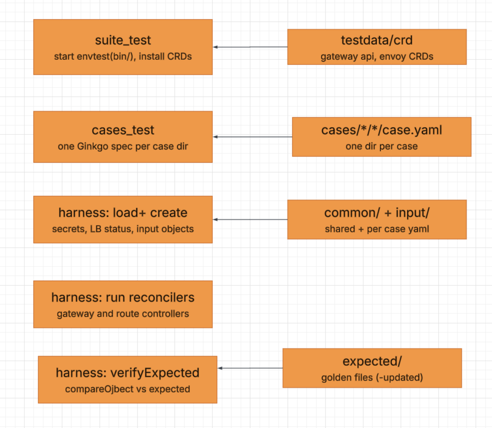

# Run the whole controller suite
go test ./pkg/gateway_api -run TestControllers -v -count=1

# Run one case (Ginkgo focus on the spec name)
go test ./pkg/gateway_api -run TestControllers -count=1 -ginkgo.focus "cross-protocol/same-hostname"

# Regenerate golden files in expected/
go test ./pkg/gateway_api -run TestControllers -count=1 -update

  

# How to add a case
Create a directory testdata/cases/<group>/<case>/. The spec name comes from the path, e.g. cross-protocol/same-hostname.
Add case.yaml and an input/ folder with the Gateway, routes and any other objects the case needs. 